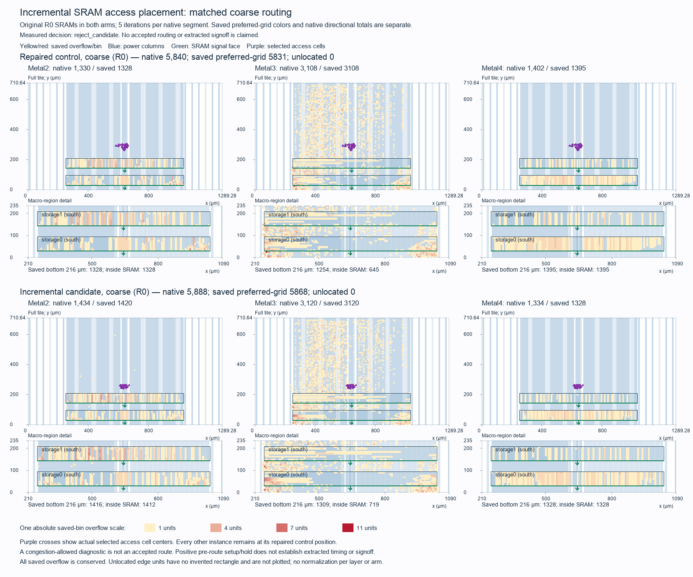

# Buffered Tiny Tapeout incremental SRAM access placement

The candidate is rejected. Matched coarse overflow rises from 5,840 to 5,888
(+0.822%), and slow estimated setup slack falls by 17.72 ps to +0.990530 ns.
Typical/fast setup, all hold margins and electrical violation counts remain
unchanged. The local movement contract passes; the candidate fails both frozen
acceptance gates for lower congestion and preserved timing.

This single experiment starts from the exact repaired R0 post-CTS database.
It moves only the SRAM address shell, without repeating global placement, CTS
or timing repair. Core RTL, serial ABI, cell masters and logical connections
remain unchanged.

The earlier [address-driver fence experiment](tt-buffered-access-placement.md)
moved much of the chip during global placement and repair, and was rejected.
This experiment holds every instance outside its frozen access cohort at its
original position, orientation and placement status.

## Physical hypothesis and allowed changes

The address cohort contains twelve final SRAM address drivers and thirty
bank-exclusive combinational predecessors. The bank0 shell contains 23 cells;
bank1 contains 19. Each predecessor's output loads belong entirely to its own
bank's address shell. Shared fanout and repair buffers, state, clocks, ties,
other SRAM interfaces and unrelated logic are excluded.

The local treatment chooses moderately nearer, unoccupied legal row slots.
The destination search admits no collateral neighbors. Moving the exclusive
shell together preserves its internal logical gate chains; incoming signals from
fixed logic can become longer. Host placement-distance and incident-net HPWL
calculations expose that tradeoff, but do not predict routing or delay.

The candidate temporarily sets every unselected instance to `FIRM`, relocates
only the frozen cohort, runs one bounded detailed legalization, and restores
every original placement status. The final candidate must pass the native
placement check and an independent whole-database readback. No global placement,
new clock tree, resizing, buffer insertion or new fence/region is admitted.

Readback must prove unchanged instance names, masters, dimensions, logical
terminals, clock connections, rows, blockages, routing rules, macros, template
pins and complete supply geometry. Unselected positions and orientations must
match exactly. Selected positions must fit the windows frozen before CAD;
the allowlist cannot grow after measurement.

## Comparison and acceptance

Both arms use the same five-iteration-per-segment coarse routing Tcl, native
clock-NDR fallback, libraries, constraints, routing capacities and resources.
Native directional overflow and saved preferred-grid overflow remain distinct.
Historical full-routing values are separate references.

Both original control and candidate receive fresh three-corner estimated STA.
The control must reproduce the retained repaired timing. The candidate must
preserve every setup margin within 0.000010 ns, retain the slow +1 ns target,
have no setup/hold failures and positive hold, and have no worse slew or fanout
counts with zero capacitance violations. Conditional fast screening still
combines −40 °C logic/I/O with −55 °C SRAM.

Congestion must fall below the matched fresh control. Fresh power connectivity,
macro/pin/supply geometry, logical export and finite mapped upload-to-pins
validation are separate gates. Placement and coarse diagnostics do not establish
accepted routing, extracted timing, DRC/LVS or official precheck.

The original repaired Librelane producer remains failed on inherited 30,396
pre-helper power metrics. A successful local native command has its own receipt;
it does not change that historical producer status or certify the complete flow.

## Measured results

The native producer passes in 12.944 seconds. Exactly 42 of 28,962 instances
move; every other 28,920 instance remains identical, including all 4,009
instances associated with actual CLOCK nets. No neighbors move. Both native
placement legality and independent serialized inventory checks pass. Every
original placement status is restored before the placement check and outputs.
The before/after logical netlists are byte-identical to the repaired reference.

Actual selected-cell center displacement from the original positions ranges
from 8.04 to 93.12 µm, totaling 1,907.46 µm. Final positions match every frozen
seed exactly. Native legalization's zero displacement/HPWL change is measured
from those already-relocated seeds, and must not be read as zero change from the
source database.

The twelve address-driver placement proxies shorten from 2,466.20 to
2,120.74 µm (−345.46 µm, about 14%). All twelve improve individually by
7.08–56.82 µm. Across all 89 incident nets, the instance-center HPWL proxy
instead grows from 7,796.00 to 9,065.86 µm (+1,269.86 µm): 47 incoming boundary
nets grow 1,502.70 µm, while 30 internal nets grow 112.62 µm. These are placement
proxies; actual native routing and fresh STA decide acceptance.

| Matched coarse routing metric | Repaired control | Incremental candidate |
| --- | ---: | ---: |
| Metal2 native overflow | 1,330 | 1,434 |
| Metal3 native overflow | 3,108 | 3,120 |
| Metal4 native overflow | 1,402 | 1,334 |
| Total native overflow | 5,840 | 5,888 |
| Saved preferred-grid overflow | 5,831 | 5,868 |
| Unassigned saved overflow | 0 | 0 |
| Native routed wirelength, µm | 2,516,270 | 2,520,064 |
| Routed nets | 28,940 | 28,940 |
| Automatic clock-NDR fallback events | 8 | 8 |
| All-in routing time, seconds | 50.303 | 47.460 |

Metal4 improves by 68 overflow units, while Metal2/Metal3 worsen by 104/12;
total overflow rises by 48. Native wirelength increases 3,794 µm (+0.151%).
Routing can change across the chip even when the only placement change is the
frozen 42-cell cohort. Neither congestion-allowed diagnostic is accepted routing.

Both arms use identical axes and one absolute saved-bin color scale, with the
same 160 actual full-height Metal4 power columns. Purple crosses show actual
access-cell centers in the full-tile panels. The macro-detail panels cover
y=0–235 µm, below the moderate access cohort; their absence there does not imply
that the cohort did not move. Native directional totals and saved preferred-grid
totals remain separately conserved measurements.

| Fresh estimated STA corner | Control setup / hold | Candidate setup / hold |
| --- | ---: | ---: |
| Typical, 1.20 V / 25 °C | +6.361640 / +0.164109 ns | +6.361640 / +0.164109 ns |
| Slow, 1.08 V / 125 °C | +1.008250 / +0.278249 ns | +0.990530 / +0.278249 ns |
| Conditional fast, 1.32 V | +9.588290 / +0.0960465 ns | +9.588290 / +0.0960465 ns |

Fresh control STA reproduces the original measurements. Candidate STA uses
its actual new database, with no inherited candidate metrics. Both arms have
zero setup/hold failures, slew counts 0/2/0, fanout counts 254 at each corner,
and zero capacitance violations. The candidate loses only the slow setup margin:
17.72 ps relative to the control, missing the separate +1 ns target by 9.47 ps.
The worst slow reset-to-SRAM endpoint shifts from `A_ADDR[2]` to `A_ADDR[5]` on
storage0; this does not identify the loss as one individual wire's delay.
Fresh control/candidate STA takes 44.769/42.841 seconds all-in.

Fresh both-net whole-grid connectivity passes in 12.882 seconds. Original R0
macro footprints, all 43 template signal pins, complete supply metal/via
geometry, every movement bound, native clock membership, placement blockages,
block NDR associations/definitions and all technology LEF rules remain exact.
Fresh logical export from that same database passes in 1.772 seconds.

The unchanged canonical mapped upload-to-pins checker passes 21 peers,
400 request/response pairs, 336,426 zero-delay edges and three parser negatives.
It consumes the exact new scratch descriptor and fresh export of the same
candidate database used for STA, power and routing. All-in host runtime is
113.005 seconds (112.911 seconds inside the canonical checker), below the
separate 300-second cap. This is finite functional validation, not a universal
RTL equivalence or physical timing proof.

Keep the repaired R0 checkpoint as the timing reference. This experiment shows
that the access shell can be relocated without disturbing the rest of the
placement, but the selected relocation improves neither total congestion nor
the strict setup-margin target. Routing/electrical closure, source-flow power
metric bookkeeping, extracted timing, SRAM corner qualification, DRC/LVS and
official precheck remain open.

## Evidence

The [frozen selection](../../physical/experiments/tt-buffered-access-incremental-selection.json)
and [result manifest](../../physical/experiments/tt-buffered-access-incremental-results.json)
bind the source database, exact policy, measurements and current source bytes.
Raw logs, databases, full inventory snapshots and helper sources stay under
ignored `build/` paths. Earlier measured evidence remains unchanged.

The physical allocation is 1,500 seconds. Reserved all-in caps total 1,165
seconds: one candidate 120, two routes 230 each, two STA checks 170 each,
logical export 105, fresh power/readback 80, and host analysis/custody 60.
The remaining 335 seconds do not authorize another placement candidate.
Mapped zero-delay validation has a separate 300-second host cap.

All seven physical diagnostics settle within their individual caps, totaling
212.971 seconds including staging, native execution, logical export, owned cleanup and hashes.
Host controls, analysis and final custody use their inclusive 60-second allowance;
charging the entire allowance conservatively yields 272.971 of 1,500 seconds.
Metered host components are not added to that allowance again. Mapped simulation
is charged separately to its 300-second host gate.
The later strict timing qualification checks report/artifact/database custody,
absolute limits and relative margins before accepting the host analysis verdict.
