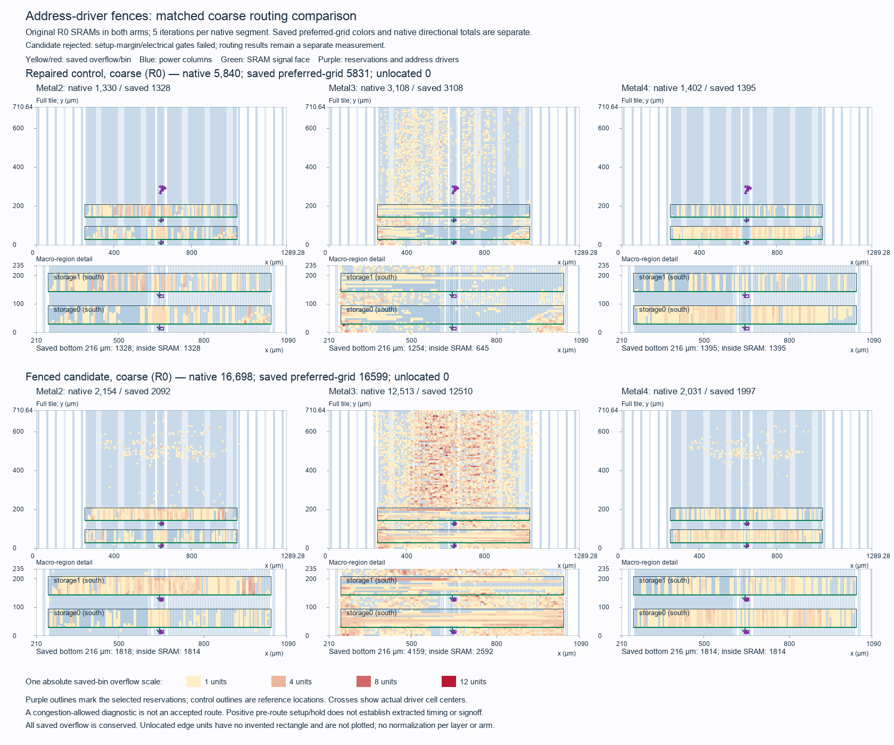

# Buffered Tiny Tapeout address-access placement experiment

The candidate is rejected. Matched coarse overflow grows from 5,840 to 16,698,
while slow setup slack falls from +1.008250 to +0.523787 ns and slew counts
increase. The [result manifest](../../physical/experiments/tt-buffered-access-placement-results.json)
binds the measurements and source custody.

This study tests one placement policy for twelve SRAM address drivers, with
both macros in their original N / OpenDB R0 orientation. The
[frozen selection](../../physical/experiments/tt-buffered-access-placement-selection.json)
binds the policy, source checkpoint, comparison and 1,800-second physical
allocation. Core RTL and the serial ABI remain unchanged.

## Hypothesis and physical treatment

Native readback of the repaired original-orientation checkpoint identifies
six distinct address drivers per SRAM. Their outputs connect exclusively to
their own bank's six `A_ADDR` terminals. The gates lie at y=264.6–302.4 µm,
while the SRAM address pins lie at y=30 / 144 µm around x=639.93–650.90 µm.
The same twelve gate names and functional nets exist in the accepted pre-GPL
checkpoint. Shared REN/WEN drivers, data logic, clocks and ties are excluded
from the selected groups.

Moving these gates nearer the south-facing pins may shorten their twelve
output tails and reduce local crossing demand. Their input nets may lengthen.
This is a physical hypothesis; timing and congestion require measurement.

| Bank | Selected mapped gates | Fence, µm | Legal row origins, µm |
| --- | --- | --- | --- |
| Storage0 | `_21850_`, `_21865_`, `_21878_`, `_21891_`, `_21901_`, `_21910_` | [641.28, 7.56, 657.60, 18.90] | 7.56, 11.34, 15.12 |
| Storage1 | `_21914_`, `_21917_`, `_21920_`, `_21923_`, `_21926_`, `_21929_` | [641.28, 120.96, 657.60, 132.30] | 120.96, 124.74, 128.52 |

Each rectangle is 16.32 µm wide and 185.0688 µm², entirely within three actual
legal rows. Boundaries align to the 0.48 µm site pitch and 3.78 µm row height.
No row cut, macro halo, power geometry or macro footprint is relaxed. The
selected gate area fits below the unchanged 55% placement target.

These are exclusive physical regions, represented as DEF FENCE / OpenDB
EXCLUSIVE. The pinned global and detailed placers reserve the rectangles from
nongroup cells; a region labelled GUIDE would not provide a dependable soft
hint in the examined paths. The repaired control has eleven/fifteen nongroup
cells overlapping the rectangles, with 117.936/139.7088 µm² of clipped area.
Those cells may move. The treatment targets twelve gates; it does not claim
that only twelve cells change location during global placement, CTS or repair.

One metadata-only region/group step runs after the exact accepted
`Odb.ApplyDEFTemplate` checkpoint and before the retained capacity-aware GPL.
At insertion, cell masters, positions, orientations, placement status, logical
terminals, rows, macros, template pins and supply geometry must remain identical.
The new region assignments are the only admitted insertion change. Their
actual surviving members and final boxes must be checked after native repair.

## Controlled comparison and gates

The control is the exact repaired R0 post-CTS ODB with retained slow setup
slack +1.008250 ns. The candidate reuses that recipe's original pre-GPL state,
adds only the regional policy, then reruns GPL, legalization, CTS and native
setup-then-hold repair. `DELAY 1` mapping, density 55, actual routing-capacity
feedback, `PL_TIMING_DRIVEN=false`, libraries, repair settings and timing
constraints remain fixed. Synthesis, floorplan, macro placement and power
generation are not repeated.

Both arms use matched coarse routing: five iterations per native segment,
unchanged native automatic clock-NDR fallback, the same routing Tcl, capacity
settings, libraries, SDC, image and compute resources. Each has a 175-second
work cap, 50 seconds for owned cleanup and five seconds for staging/hashes.
No full 50-iteration attempt or second placement policy is allocated.
Historical full-routing values 2,255 / 6,724 remain separate references.
A timed-out arm prevents a completed paired congestion comparison.

The placement policy succeeds only if native coarse overflow falls below the
matched control and every previous setup margin is preserved within 0.000010 ns.
The separate slow repair target remains +1 ns. Fresh exact-ODB STA must reproduce
the checkpoint's nominal measurements, have zero setup/hold failures, positive
hold, slew counts no worse than 0/2/0 at typical/slow/fast, fanout at most 254
per corner and zero capacitance violations. Fast remains conditional −40 °C
logic/I/O with −55 °C SRAM.

Fresh logical export and mapped upload-to-pins validation use the same final
ODB as STA and power checks. Both supply nets, complete supply geometry,
original macro orientation/footprints, all 43 template signal pins and effective
fence membership/placement are independent gates. They do not establish
extracted timing, SRAM corner qualification, DRC/LVS or official precheck.
The native flow's inherited 30,396 pre-helper power count remains a separate
producer failure unless a real native measurement refreshes its provenance;
fresh connectivity alone does not waive that checker.

## Measurements

The fresh repaired-control coarse route completes in 47.433 seconds including
staging, execution, owned cleanup and hashes. Native overflow is 5,840:
Metal2 1,330, Metal3 3,108 and Metal4 1,402. The saved preferred-direction grid
contains 5,831 units, all spatially located. Native directional totals and saved
grid totals are different representations and remain separate. Eight automatic
NDR fallbacks occur. Cell inventory and logical netlist remain unchanged by this
diagnostic; congestion acceptance does not establish an accepted route.

The candidate completes its sole placement/CTS/repair continuation in 193.474
seconds and reaches the final post-CTS STA checkpoint. The overall producer
exits 2 on the inherited 30,396 power count. Its completed checkpoint is
admitted for independent diagnostics with that failure preserved.

Fresh native power readback passes VPWR/VGND connectivity, both original R0
footprints, all 342 south-facing signal rectangles per SRAM, the 68/64/68 supply
contacts, complete supply wire/via/boundary geometry and all 43 template signal
pins. Both exact six-member fences survive, with all twelve gates inside the
approved boxes and still directly driving their original address terminals.
The native connectivity/fence diagnostic takes 8.739 seconds. This validates
the implemented treatment, while leaving the overall producer failed.

The matched candidate coarse route completes in 64.424 seconds. Routing leaves
cell inventory and logical netlist unchanged within each arm.

| Matched coarse metric | Repaired R0 control | Address-fenced candidate |
| --- | ---: | ---: |
| Metal2 native overflow | 1,330 | 2,154 |
| Metal3 native overflow | 3,108 | 12,513 |
| Metal4 native overflow | 1,402 | 2,031 |
| Total native overflow | 5,840 | 16,698 |
| Saved preferred-grid overflow | 5,831 | 16,599 |
| Spatially unassigned saved units | 0 | 0 |
| Automatic NDR fallbacks | 8 | 8 |
| Aggregate resource usage | 64.02% | 70.28% |
| Native total wirelength | 2,516,270 µm | 2,743,387 µm |

The candidate adds 10,858 native overflow units, a 185.925% increase. Every
routing layer worsens, with Metal3 the largest regression. These are completed
matched coarse-five-iteration diagnostics, with no full-routing equivalence
or accepted-route claim.

The [vector figure](figures/tt-buffered-access-placement-coarse.svg) uses identical
axes and one absolute saved-bin color scale. Saved overflow below y=216 µm
rises from 3,977 to 7,791 units. Metal3 above that region grows from 1,854 to
8,351 units; its lower-region overflow grows from 1,254 to 4,159. The regression
extends across the logic field. Spatial overlap and automatic retry counts do
not identify a causal share for one net, obstruction or clock rule.

Host DEF readback agrees with native power readback for every selected gate's
master, location, orientation, group and direct address net. All 26 baseline
cells overlapping the reservations move or are removed during repair, and none
still overlap. Global
placement/repair changes 25,171 retained cell bounding boxes and 615 retained
masters; five bank0 address gates downsize from the control's `a21o_2` to
`a21o_1`. The sum of cell-center-to-address-pin Manhattan distances shrinks
from 2,466.20 to 260.10 µm. That is a placement proxy, not routed tail length
or delay. Native total wirelength rises by about 9%. Shorter local endpoint
distances do not establish a better complete layout.

| Fresh pre-route setup / hold | Repaired control | Address-fenced candidate |
| --- | ---: | ---: |
| Typical | +6.361640 / +0.164109 ns | +6.051610 / +0.166310 ns |
| Slow | +1.008250 / +0.278249 ns | +0.523787 / +0.294673 ns |
| Fast, conditional | +9.588290 / +0.096047 ns | +9.392180 / +0.091947 ns |

Fresh three-corner STA takes 41.633 seconds and reproduces the final native
nominal measurements exactly. Setup and hold failures are zero at every
screened corner, but all three setup margins decline. Slow loses 0.484463 ns
and misses the unchanged +1 ns target. Typical/slow slew counts increase from
0/2 to 7/7; fast remains zero. Fanout stays 254 per corner and capacitance
violations stay zero. The native setup-repair warning therefore accompanies
a missed repair-margin target, despite zero fresh setup failures. Estimated
timing with a conditional fast screen remains separate from extracted signoff.

A fresh logical export of the same ODB passes in 2.138 seconds. Its mapped
upload-to-pins replay passes 21 peers, 400 request/response pairs, 336,426
zero-delay edges and three parser negatives in 122.036 seconds. All 495/494
accepted source entries and the canonical checker remain unchanged.

Reject the fence policy for both congestion and full timing-gain preservation.
Keep the earlier repaired R0 checkpoint as the timing reference and the older
layout as the historical routing reference. Another physical hypothesis should
control the broad placement response rather than assume that shortening a
small address-access proxy improves the entire chip. Routing, slew/fanout repair,
power-metric bookkeeping, extracted timing, DRC/LVS and official precheck remain
open.

## Evidence and limits

Native read-only inspection completes in 3.059 seconds, without optimization
or input changes. The physical envelope initially reserves 1,635 of 1,800 seconds for
inspection, one preflight, one candidate, two coarse routes, fresh STA/export/
power and host closeout. A supplemental 30-second host-only allowance uses the
previously unallocated reserve, bringing the reservation to 1,665 seconds;
all CAD caps and the physical policy remain unchanged.
Mapped zero-delay simulation has a separate 900-second
host cap and performs no physical optimization.

Large logs, ODB/DEF views, helper sources and geometry remain under ignored
`build/` paths. The tracked selection and final result manifest bind their
bytes. All earlier physical results and failed receipts remain unchanged.

Metered physical diagnostics total 373.582 seconds, and metered host checks,
analysis, copying and custody total 8.574 seconds. A further conservative
30-second allowance covers intake, staging, failed collector attempts and
final root checks: charged work is 412.156 of 1,800 seconds. Mapped simulation's
122.036 seconds remain separate from physical optimization. The final custody
audit finds all eight experiment-owned containers absent.

The first host custody collector fails on a receipt-relative source path;
its invocation is retained and the corrected collector uses the proper base.
It also identifies a supplementary DEF receipt taken before its helper's final
preparation. The exact executed helper bytes are recovered and hash-verified,
the old receipt remains unchanged, and a fresh readback with the frozen helper
reproduces its measurements. The final analysis computes numerical placement
metrics independently from fresh native route geometry and power metadata;
the supplementary receipt supplies only its historical producer-status reference.
This custody correction launches no CAD or additional placement experiment.
