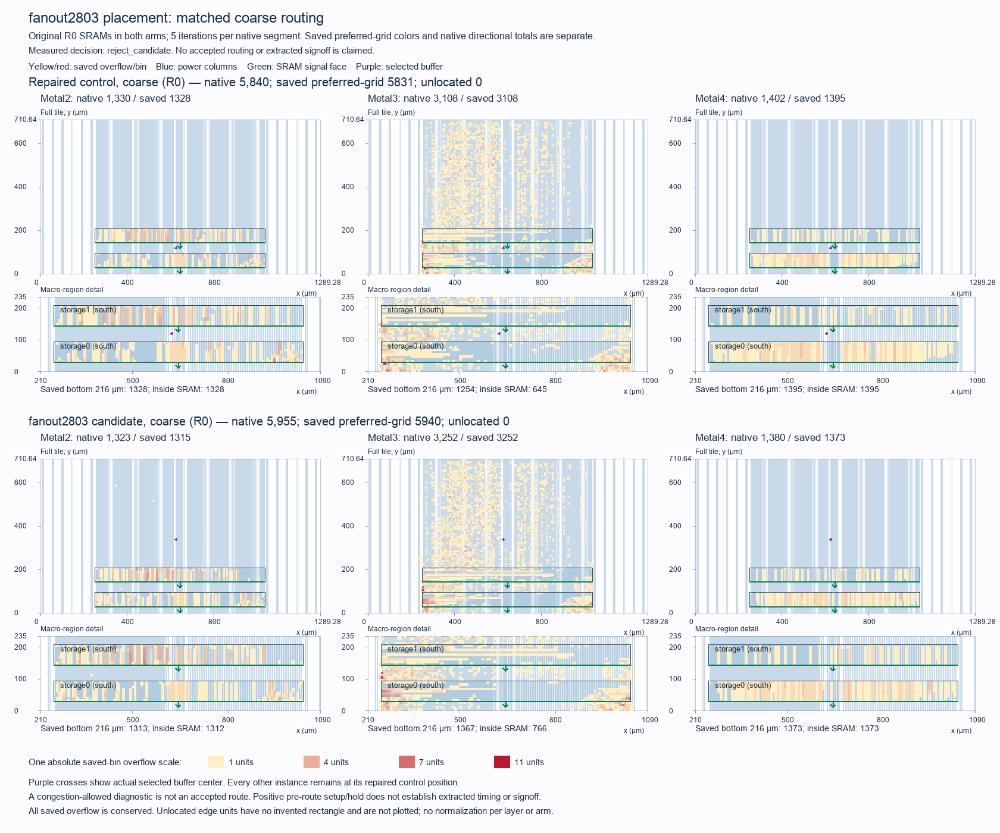

# Tiny Tapeout fanout2803-only placement comparison

The candidate **is rejected**. Reject the single-buffer candidate; retain the original repaired R0 checkpoint. Native coarse overflow 5840 → 5955 (+115); zero-capacity overflow 3328 → 3415 (+87). Submission remains unready. The [result manifest](../../physical/experiments/tt-buffered-fanout2803-results.json) and [frozen selection](../../physical/experiments/tt-buffered-fanout2803-selection.json) bind this comparison. The [preceding two-buffer study](tt-buffered-two-buffer.md) remains historical evidence.

The source ODB is `95f0fdb260de137d5b4f77669c9aaa5eb3bf56e7dc55f4c9b7d51b2b8a16556e`; the candidate ODB is `5b1facdfe0466e09b580e97454d2a33c62601cd911df84a4efe5f257434348b2`. One detailed-placement call moves only `fanout2803` from lower-left (622.56,117.18) to (622.56,336.42) µm, preserving R0 orientation and its `buf_1` master. Native readback confirms one moved instance and 28,961 unchanged instances, with zero neighboring movement. `fanout2903` remains at (618.72,113.40) µm, MX. All other positions/orientations, masters, logical connections, restored statuses, clocks, rows, blockages, groups, pins, SRAM footprints/orientations, complete power geometry, TechLEF and initial NDR rules/associations remain unchanged. Core RTL, serial ABI and the canonical recipe remain unchanged; GPL, CTS, synthesis, resizing and buffering are not rerun.

The two incident-net center-HPWL proxies total 1,308.78 → 1,097.10 µm. This is a placement proxy, not routed length or delay. Both arms use the same pinned tools, libraries, SDC, resource definitions and five iterations per native routing segment. Native automatic clock-NDR fallback is retained; actual retries are 8 control and 8 candidate. Post-GRT NDR state is not asserted identical. These congestion-allowed coarse diagnostics are not accepted routing or equivalents of retained full 50-iteration counts.

| Routing measure | Original repaired control | Single-buffer candidate | Change |
| --- | ---: | ---: | ---: |
| Metal2 overflow | 1,330 | 1,323 | -7 |
| Metal3 overflow | 3,108 | 3,252 | +144 |
| Metal4 overflow | 1,402 | 1,380 | -22 |
| Total native overflow | 5,840 | 5,955 | +115 |
| Saved preferred-grid overflow | 5,831.0 | 5,940.0 | +109.0 |
| Zero-capacity marker overflow | 3,328 | 3,415 | +87 |
| Native wirelength, µm | 2,516,270 | 2,520,079 | +3,809 |
| Routed nets | 28,940 | 28,940 | +0 |

All saved overflow units have locations. Native directional and saved preferred-grid totals are distinct. The figure uses shared absolute colors and axes with actual macro/pin/power geometry.

The selected input `_09502_` has 51 → 0 zero-capacity source incidences; output `net2803` has 0 → 4. The cohort's zero-capacity exposure is 51 → 4. [Marker participation](../../build/physical/tt-buffered-fanout2803-marker-analysis-01/report.json) also retains unselected-net changes. Counts describe exposure, not causal ownership or guaranteed removable units; global rerouting can alter unchanged nets.

The redistribution is visible in native Metal3 overflow, 3,108 → 3,252. In the separate saved preferred-grid representation, Metal3 overflow inside the SRAM-footprint region changes 645.0 → 766.0 units. Unselected `_12695_` participates in 0 → 89 zero-capacity net-edge occurrences. This supports measured redistribution of routing pressure; native totals, saved regional units and net-edge participation are different quantities, and participation does not allocate causal responsibility.

| Fresh estimated timing | Control setup / hold, ns | Candidate setup / hold, ns |
| --- | ---: | ---: |
| nom_typ_1p20V_25C | +6.361640 / +0.164109 | +6.361640 / +0.164109 |
| nom_slow_1p08V_125C | +1.008250 / +0.278249 | +1.008250 / +0.278249 |
| nom_fast_1p32V_m40C | +9.588290 / +0.096047 | +9.588290 / +0.096047 |

| Candidate electrical counts | Setup / hold violations | Slew / fanout / capacitance violations |
| --- | ---: | ---: |
| nom_typ_1p20V_25C | 0 / 0 | 0 / 254 / 0 |
| nom_slow_1p08V_125C | 0 / 0 | 2 / 254 / 0 |
| nom_fast_1p32V_m40C | 0 / 0 | 0 / 254 / 0 |

Timing gate: **True**; global native and zero-capacity congestion gate: **False**. Setup-margin comparisons use the frozen 0.000010 ns reporting tolerance. STA uses placement parasitics; the fast corner retains −40 °C logic/I/O versus −55 °C SRAM qualification. No timing paths or external delay constraints are relaxed.

Fresh VPWR/VGND connectivity, supply wire/via/boundary geometry, 43 TT signal-pin shapes and exact one-cell movement pass. Grid SHA256 is `1598525bac6715417b1c54500a99a5751cdb53f0d83a0348f5f570531ec1ebb7`. Fresh export of this candidate passes 21 protocol peers, 400 request/response pairs, 336,426 zero-delay edges and 3 parser negatives in 119.037 s. Native logical netlist bytes remain identical. These finite functional checks do not establish universal equivalence or physical signoff.

All scheduled work and cleanup finish at 2026-10-12T20:26:10.677930+00:00, 948.678 s after the 2026-10-12T20:10:22Z start, within the fixed 2026-10-12T20:35:22Z deadline. Native operations total 196.717 s; mapped supervision uses 119.093 s. Owned containers are absent and the mapped process group is stopped. [Independent final custody](../../build/physical/tt-buffered-fanout2803-review-01/final-custody-review.json) passes.

The original LibreLane reference flow remains failed on 30,396 inherited pre-helper power metrics. Fresh connectivity does not waive that failure. Accepted routing, detailed routing, extracted timing, corner qualification, DRC/LVS and official precheck remain open. No second candidate, full-routing attempt, commit, push or submission occurs here.
