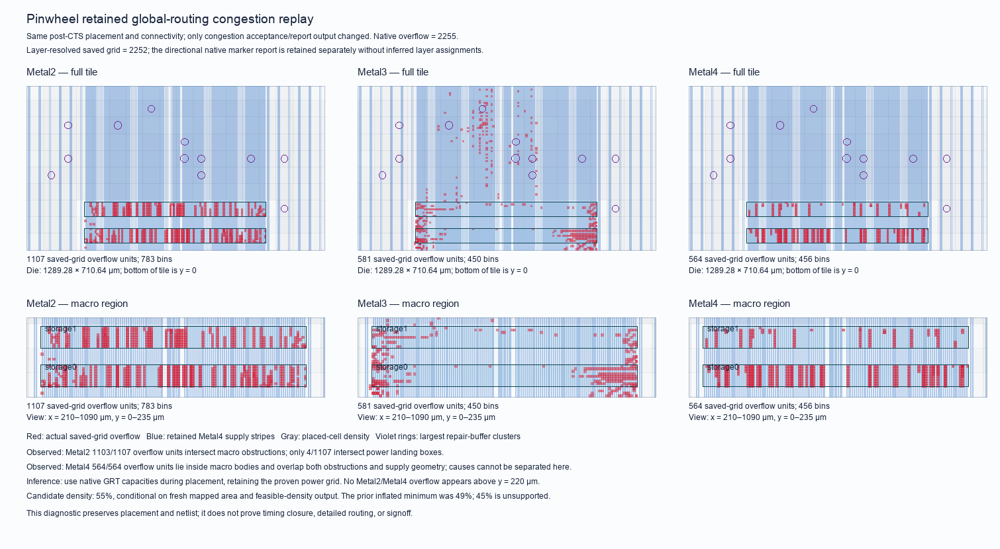

# Buffered Tiny Tapeout congestion and timing repair

The authorized candidate keeps the buffered engine RTL, public Tiny Tapeout
ports, serial ABI, SRAM views, macro positions, power grid and timing budgets
unchanged. It changes synthesis mapping, placement feedback and native physical
repair targets. The repaired checkpoint clears the twelve setup failures and
passes mapped upload-to-pins, but routing overflow grows from 2,255 to 6,724.
The placement bundle is rejected. One full attempt and one checkpoint recovery
consume 1,210.423 seconds of the original 1,800-second allocation. The
[result manifest](../../physical/experiments/tt-buffered-locality-results.json)
binds the measurements, failed stages and source custody.

## The measured bottleneck

A 105.380-second checkpoint replay reproduces the previous run's 2,255 native
overflow units exactly, including wirelength and routing-via count. Original
and copied inputs, cell masters/locations/orientations, terminal connectivity
and exported logical netlist remain unchanged. Congestion acceptance is enabled
only in this diagnostic to retain the failed route's map.



| Layer | Native overflow | Saved preferred-direction grid | Location |
| --- | ---: | ---: | --- |
| Metal2 | 1,108 | 1,107 | 1,103 units overlap native SRAM obstructions; four overlap power landing boxes. |
| Metal3 | 581 | 581 | Concentrated at macro ends, with a smaller central corridor; 352 units lie within 10 µm of a macro. |
| Metal4 | 566 | 564 | All 564 saved units lie inside macro footprints and overlap both obstructions and supply columns. |
| Total | 2,255 | 2,252 | The native directional markers and saved layer grid retain their different representations. |

No Metal2 or Metal4 saved overflow appears above y = 220 µm. The map supports
using actual routing capacities to guide placement around macro obstructions
and access corridors. It does not isolate a single causal net, distinguish
Metal4 macro obstruction from supply geometry, or justify changing the proven
power grid. Native markers omit layer names; ambiguous markers remain
unassigned rather than receiving guessed layer identities.

Of the 2,252 saved preferred-direction units, 2,123 (94.27%) lie in the bottom
216 µm, covering the two SRAMs and their access corridors. This spatial result
applies to the previous placement; the failed new router emits no after-map.

The previous routability-driven placement used the default estimator and a
50% target. Its measured inflated area/free area ratio was about 49.9%, so
lowering the target to 45% would be infeasible. The candidate uses 55% to allow
local inflation; the native placer must still report a feasible density for
the new mapping. This is an experimental setting, not a routing pass.

## Why the timing repair changed

The previous fresh slow-corner checkpoint had twelve setup failures: eleven
`ena` → SRAM address endpoints and one response-counter → MISO endpoint.
Its 20 ns clock, 4/0.2 ns I/O delays and reset/enable paths stay constrained.
The native resizer already loaded all three requested corners and repaired
all violating endpoints; relabeling a corner or declaring 100% TNS coverage
would not independently fix those paths.

One copied post-CTS probe adds native output buffers and strengthens the setup
repair target to 1 ns, retaining the setup-then-hold sequence and existing hold
margins/buffer limits. In 58.663 seconds it improves slow setup slack from
−0.734781 ns to −0.525121 ns, with positive hold at all screened corners. It
does not clear setup. The probe buffers outputs after CTS, whereas the full
flow's native output-buffer setting acts before CTS; those results cannot be
transferred directly to the full candidate.

The old MISO path has 72 cell output arcs contributing 15.257519 ns, versus
0.011219 ns in input/net arcs. Cell delays also include load effects, so this
does not prove placement has no influence. It does motivate measuring a
different mapping on unchanged RTL.

Exactly one `DELAY 1` synthesis screen completes in 96.048 seconds with no
unmapped cells or synthesis check errors. Standard-cell area grows 4.07%, from
331,103.5056 to 344,572.4394 µm². The static longest MISO cone grows from 71 to
81 cells and global ABC delay regresses. A fresh native cell-only slow-corner
STA nevertheless improves the actual MISO endpoint:

| Mapping | MISO arrival | Required | Slack |
| --- | ---: | ---: | ---: |
| Original `AREA 0` | 12.903031 ns | 15.800000 ns | +2.896969 ns |
| Candidate `DELAY 1` | 12.392703 ns | 15.800000 ns | +3.407297 ns |

The 0.510328 ns endpoint improvement supports trying this mapping; structural
depth alone does not predict timing. Unbuffered `ena` → SRAM address timing
worsens and still needs physical repair. Cell-only slack is not added to the
old placed slack or treated as proof of closure. Two failed report-hook
attempts are retained before the 9.802-second successful STA; neither starts
another synthesis or physical flow.

## Frozen candidate

The SHA-bound [recipe](../../physical/experiments/tt-buffered-locality-repair.json)
is applied to an unused prepared stage by the
[recipe helper](../../scripts/apply-buffered-tt-physical-recipe.py). It retains
the original seventeen input files/configuration, checks its measurement
references, protects all other configuration and rejects runs, reapplication,
arbitrary file replacement or altered evidence. Fourteen focused rejection and
rollback controls pass.

The candidate selects `DELAY 1`, timing-driven placement, 55% density and
native output buffering. The copied pinned GPL script adds only
`-routability_use_grt`; its common scripts and actual routing-capacity
adjustments remain unchanged. Setting `PL_KEEP_RESIZE_BELOW_OVERFLOW=0` reverts
temporary GPL resizing while preserving timing feedback; later native repair
owns physical cell changes. PL/GRT setup targets become 1 ns, with explicit
100% repair coverage. Setup-then-hold ordering, all three libraries, hold
margins, buffer limits and foundry checks remain intact.

The resolved configuration enables post-GPL design repair and post-CTS timing
repair. Post-GRT design and timing repair are disabled, so the selected GRT
margin/coverage settings are inert in this baseline. They do not constitute
an additional optimization pass.

The single full candidate is `tt-buffered-locality-repair-02`, run
`tt-buffered-physical-05`: at most 1,800 seconds, four CPUs, 6 GiB and no
network. It uses the same 6×4 official pin template and Metal4 routing limit.
Detailed routing, extracted timing, power analysis, DRC/LVS and official TT
precheck remain separate acceptance gates until their actual results exist.

## Placement tool failure and bounded recovery

The initial attempt aborts after 147.496 seconds at
`Project.BufferedCapacityPlacement`. OpenROAD's second virtual timing-repair
iteration calls detailed-placement legalization while global-routing
parasitics are present. `Opendp::legalPt` fails a horizontal `std::clamp` range
assertion and terminates with signal 6. Pinned source is consistent with an
uninitialized or stale legalization grid in that interaction; the runtime
dimensions were not logged, so the precise cause remains unproved.

The placer reports a minimum internal congestion score of 1.1153 after fourteen
inflation iterations. This is not comparable to the previous router's 2,255
overflow units and is not an accepted placement or routing result. No placement
output state, CTS, post-repair corner timing or route exists for this attempt.
All staged inputs remain unchanged and owned-container cleanup is confirmed.

The clean supported recovery uses the last completed step 28 checkpoint,
turning off only `PL_TIMING_DRIVEN` during GPL. Actual GRT capacity feedback,
mapping, output buffering, post-GPL design repair, post-CTS timing repair,
setup-then-hold order and all budgets/checks remain unchanged. It uses a new
output directory and a read-only mount of the failed candidate. A maximum
1,590-second CAD continuation cap plus 60 seconds for owned-container cleanup
and verification and the consumed 147.496 seconds is below the original
1,800-second allocation. The actual subprocess timeout is 1,589 seconds.
Synthesis, floorplan and power stages are not rerun.

The [recovery selection](../../physical/experiments/tt-buffered-locality-recovery.json)
binds the exact state, copied configuration, driver and passing no-CAD native
initialization control. The completed continuation is frozen stage
`tt-buffered-locality-recovery-02`, run `tt-buffered-physical-05-recovery-01`.
The unused recovery-01 accounting draft is preserved without a CAD launch.

The initial attempt's synthesized netlist independently passes all twenty-one
SPI/JTAG/I²C public-pin cases in 90.548 seconds, including 400 request/response
pairs and 336,426 zero-delay edges. Its source files still match both the 495
boundary inputs and the 494 broader RTL inputs. This is pre-placement mapped
acceptance, with no latest repaired ODB or routed-timing claim.

## Settled result

The recovery completes placement, design repair, CTS and setup-then-hold
repair. Its router then fails with congestion, after eight native clock-net
NDR fallback retries. The continuation takes 1,062.927 seconds; both owned
containers are absent and their frozen inputs remain unchanged. No accepted
global route, routed output database or detailed route is produced. A new
150-second map replay would not reproduce these long native retries, so no
after-map is claimed.

| Routing metric | Previous placement | Repaired placement |
| --- | ---: | ---: |
| Metal2 overflow | 1,108 | 1,628 |
| Metal3 overflow | 581 | 4,068 |
| Metal4 overflow | 566 | 1,028 |
| Total overflow | 2,255 | 6,724 |
| Aggregate resource usage | 57.16% | 69.40% |

Actual routing capacity feedback and local inflation do not improve the
retained candidate. The joint changes in mapping, output buffering, density
and repair prevent attributing the regression to one setting. The old
2,255-unit placement remains the better routing reference.

Fresh native STA loads the exact repaired post-CTS database and all nine
declared libraries. It reproduces the flow's nominal setup and hold slack
exactly; the slow and fast metrics are freshly measured rather than inherited
from the earlier state.

| Corner | Previous setup / hold | Repaired setup / hold | Repaired setup / hold violations |
| --- | ---: | ---: | ---: |
| Typical | +5.425400 / +0.249567 ns | +6.361640 / +0.164109 ns | 0 / 0 |
| Slow | −0.734781 / +0.466705 ns | +1.008250 / +0.278249 ns | 0 / 0 |
| Fast, conditional | +9.021830 / +0.092325 ns | +9.588290 / +0.096047 ns | 0 / 0 |

The twelve original slow setup failures clear at the placement-estimated
layer. Two slow slew violations and 254 fanout violations per corner remain;
capacitance violations are zero. Fast timing combines −40 °C logic/I/O and
−55 °C SRAM and retains that qualification. These are pre-route estimates,
without extracted parasitics or routed signoff. Native post-CTS repair adds
87 setup buffers and 2,323 hold buffers, with 398 resizes and 57 pin swaps.

A fresh logical export of this exact repaired database passes all twenty-one
SPI/JTAG/I²C independent public-pin peers: 400 request/response pairs, 336,426
zero-delay edges and three parser negatives in 111.329 seconds. Export-to-ODB
matching is established, all 510 mapped inputs remain unchanged, and the
495-input boundary and 494-input broader RTL intakes still match current
sources. This preserves the core RTL and serial ABI at the measured scope;
it is finite functional acceptance, not sequential equivalence.

A separate 5.982-second native check of the same database finds all VPWR and
VGND shapes connected. Special-wire geometry and wildcard supply terminals
match the previous accepted grid. This preserves the power-connectivity gate;
IR drop, current capacity and routed geometric signoff remain unmeasured.

The next physical comparison should isolate placement/access changes near the
two SRAMs and their macro ends, using the older routing reference and keeping
the proven power geometry. Retain the new timing result as a diagnostic, but
do not promote the failed bundle or thin supply columns based on overlapping
congestion alone. Routing closure, remaining electrical violations, extracted
timing, DRC/LVS and official Tiny Tapeout precheck remain open.

## Reproduction

Prepare a fresh stage with `scripts/prepare-buffered-tt-physical.py`. Create
a fresh recipe that binds that stage's original `inputs.json` and `core.json`
hashes and stable measurement references; the retained recipe is specific to
this candidate and cannot be replayed against a different intake unchanged.
The historical recipe enables timing-driven GPL and reproduces the initial
tool failure. A future fresh recipe can omit `PL_TIMING_DRIVEN` to retain the
preparer's false default, matching the measured recovery. This does not make
the rejected placement bundle suitable for submission.

```sh
python3 -B scripts/apply-buffered-tt-physical-recipe.py \
  --design build/physical/<fresh-design> --recipe <fresh-sha-bound-recipe.json>
python3 -B scripts/run-buffered-tt-physical.py \
  --design <fresh-design> --tag <fresh-run> --timeout-seconds 1800
```

The bounded runner freezes sources and staged files, verifies the pinned
runtime/PDK, rejects a preexisting container name and stops only containers
carrying its unique ownership label. Another full run requires its own
authorization; checkpoint diagnostics and the mapped public-pin replay retain
separate resource and evidence receipts.
