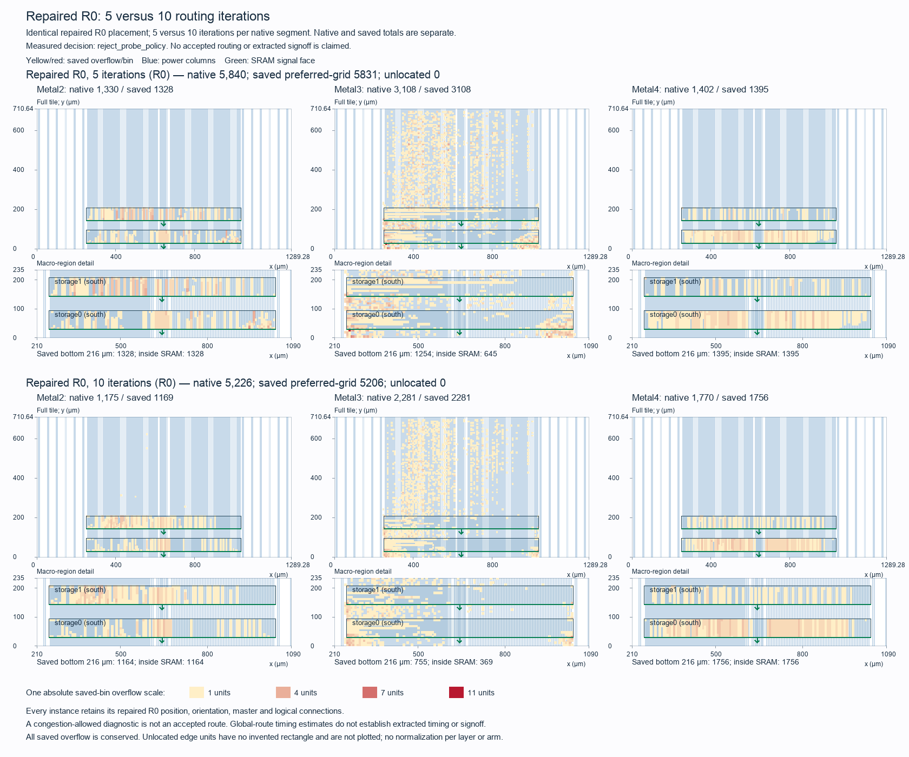

# Buffered Tiny Tapeout routing-effort comparison

The 10-iteration policy fails the strict comparison gates; retain the original repaired R0 reference. This is one bounded routing-only comparison from identical repaired R0 placement. The only input treatment is 5 versus 10 congestion iterations per native NDR retry segment. Core RTL, serial ABI, all cell placement, clock topology, masters, PG geometry, macro pins, capacity policy and technology remain unchanged.

| Measure | 5 iterations | 10 iterations | Delta |
| --- | ---: | ---: | ---: |
| Metal2 native overflow | 1,330 | 1,175 | -155 |
| Metal3 native overflow | 3,108 | 2,281 | -827 |
| Metal4 native overflow | 1,402 | 1,770 | +368 |
| Total native overflow | 5,840 | 5,226 | -614 |
| Zero-capacity native overflow | 3,328 | 3,265 | -63 |
| Saved preferred-grid overflow | 5,831.0 | 5,206.0 | -625.0 |
| Wirelength (µm) | 2,516,270 | 2,527,207 | +10,937 |

Native directional totals, zero-capacity marker totals and saved preferred-grid totals are distinct representations. The fresh 5-iteration control reproduces 5,840 total native units and 3,328 zero-capacity units. Native automatic clock-NDR fallback remains enabled; its actual retry orders are recorded in the result. Changing effort can alter those responses, so this comparison measures routing effort with the native policy rather than a pure isolated path-cost effect. Net-edge participation and hotspot overlap do not establish causal ownership.

| Acceptance gate | Result |
| --- | --- |
| native_total_improved | Pass |
| zero_capacity_improved | Pass |
| Metal3_improved | Pass |
| relative_route_RC_timing_preservation | Fail |
| strict_timing_including_slow_1ns | Fail |

The setup and hold table below uses fresh parasitics from each arm's exact serialized global-route segments and its routed database. Segment import is followed by semantic netset/coordinate/layer/multiset roundtrip checks before and after timing; no routing or placement optimization runs during STA. These values have a different parasitic basis from the earlier placement estimates, including the retained +1.00825 ns slow margin.

| Corner | 5 setup (ns) | 10 setup (ns) | 5 hold (ns) | 10 hold (ns) |
| --- | ---: | ---: | ---: | ---: |
| nom_typ_1p20V_25C | 5.675080 | 5.674470 | -0.049953 | 0.001912 |
| nom_slow_1p08V_125C | -0.612559 | -0.375264 | 0.052936 | 0.102800 |
| nom_fast_1p32V_m40C | 9.050160 | 9.068200 | -0.107308 | -0.054893 |

Relative setup/hold preservation and electrical counts are measured separately from zero setup/hold violations, positive hold and the absolute slow +1 ns target. Preserving a failing control margin does not establish closure. Report precision tolerance is 0.000010 ns. The fast corner remains conditional because logic/IO uses −40°C while SRAM uses −55°C.

The segment format does not serialize the router's internal NDR fallback state. Native gates verify that all route and pin-layer NDR widths equal default widths, making that state immaterial to this estimator's resistance-width ratio. The estimator uses default-layer capacitance and cut-layer via RC; NDR spacing, coupling and detailed via choices are outside this model. Annotation counts are retained in the per-corner reports, and complete parasitic annotation is not claimed.

The source-bound control ledger classifies all 167 unannotated drivers as 11 unused input ports and 156 unconnected dummy clock-load outputs. All six worst setup/hold paths have saved-net segment coverage and no unannotated driver on those paths; the negative control margins therefore are not explained by that unused-driver ledger. This checks those reported paths and does not claim extracted or universal annotation signoff. [Control annotation ledger](../../build/physical/tt-buffered-route-effort-annotation-analysis-01/report.json).

The original Librelane producer remains **failed**, exit 2, with inherited pre-helper power counter **30,396**. Preserved PG/topology inventories and retained power/finite upload evidence do not waive that bookkeeping gap. This routing-only experiment does not run a new PSM or mapped-upload test and does not establish detailed routing, extracted timing, DRC, LVS, official precheck or submission readiness.

All four fresh native phases passed execution, source custody and owned cleanup. They completed 1078.621 seconds after the 2026-10-12T20:46:47Z start. Publication snapshot: 1282.948/1,500 seconds; deadline 2026-10-12T21:11:47Z. Native phase all-in time sums to 302.967 seconds, with capability inspection separately recorded. Elapsed wall time includes preparation and closeout rather than summing only CAD phases.

All 1,140 prior custody paths and 507 protected sources remain unchanged. Earlier indexed studies and their pointer documents are preserved; this new study and result are separate artifacts.

Evidence: [result manifest](../../physical/experiments/tt-buffered-route-effort-results.json), [frozen selection](../../physical/experiments/tt-buffered-route-effort-selection-02.json), [fresh native and timing review](../../build/physical/tt-buffered-route-effort-review-01/final-custody-review.json), [analysis](../../build/physical/tt-buffered-route-effort-analysis-01/results-01/analysis.json), [SVG map](figures/tt-buffered-route-effort.svg).
