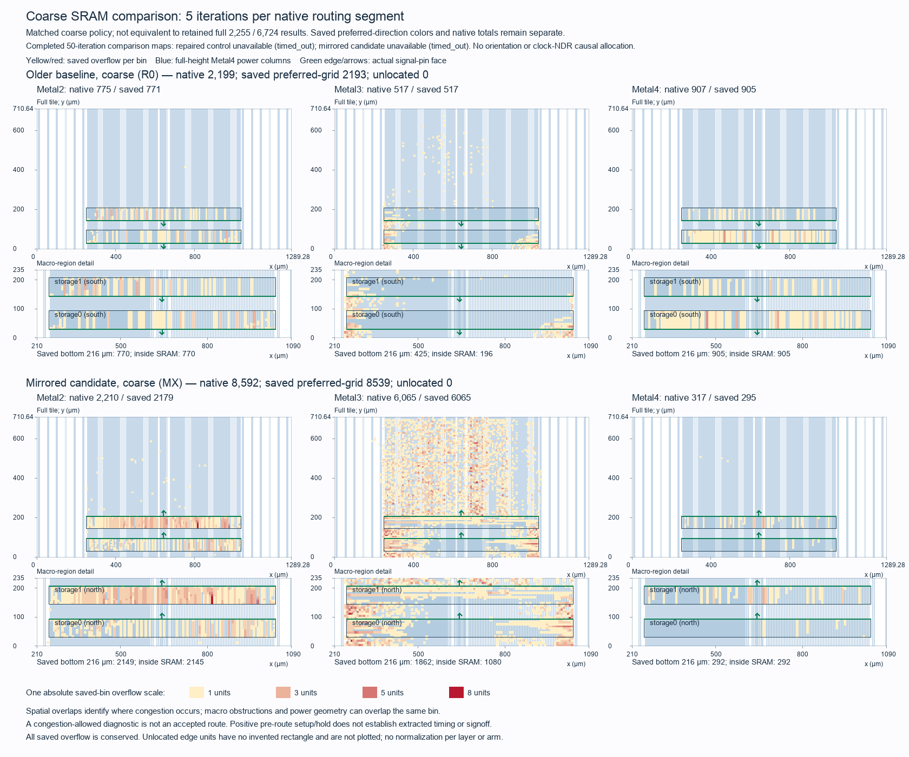

# Buffered Tiny Tapeout SRAM access comparison

The mirrored candidate is rejected. In a matched coarse routing screen,
overflow grows from 2,199 to 8,592. Setup and hold remain positive, but slow
setup margin falls from +1.008250 to +0.509791 ns and slew violations increase.
The [result manifest](../../physical/experiments/tt-buffered-sram-access-results.json)
binds the measurements and the failed full-routing attempts.

This study tests one physical change: vertically mirror both SRAMs so their
signal pins face north, while keeping their footprints fixed. Core RTL,
serial ABI, generated `DELAY 1` mapping, timing constraints and the prior
placement/repair settings stay unchanged. The
[frozen selection](../../physical/experiments/tt-buffered-sram-access-selection-03.json)
records the scope, references and 1,800-second physical allocation.

## Hypothesis and controlled change

The previous map concentrates 2,123 of 2,252 saved preferred-direction
overflow units in the bottom 216 µm around the two macros. All 342 Metal2
signal rectangles per macro face south in the original orientation. Most
logic lies north of the macros. Mirroring may let access logic escape toward
that area without detouring around the SRAM bodies. This is an inference to
measure; obstruction overlap alone does not establish one causal net.

| SRAM | Fixed footprint, µm | Original | Candidate |
| --- | --- | --- | --- |
| Storage0 | [252, 30, 1036.48, 94.36] | N / OpenDB R0 | FS / OpenDB MX |
| Storage1 | [252, 144, 1036.48, 208.36] | N / OpenDB R0 | FS / OpenDB MX |

The old immediate access cells followed the south-facing pins. Reflecting
the already-placed macros alone would lengthen those connections, so the
candidate resumes before macro placement and reruns row cutting, power
generation, global/detailed placement, CTS and setup-then-hold repair.
Synthesis and early floorplan are reused from the exact accepted checkpoint.
It stops at the final native pre-route STA checkpoint.

The experimental power helper reflects each actual Metal4 supply rectangle
about the loaded master height for MX. All 28 host transformation/admission
controls pass. Direct column contacts remain VDD 68, VDDARRAY 64 and VSS 68.
Supply-column x coordinates, widths and die-edge endpoints remain fixed;
native connectivity and complete grid readback are separate checks. The
canonical helper and all older stages remain unchanged.

## Comparison and timing gates

The older 2,255-overflow result is the routing performance target. The prior
timing-repaired candidate provides a second retained reference: 6,724 native
overflow and slow setup slack +1.008250 ns. That earlier bundle used different
mapping and repair from the older baseline, so a comparison with 2,255 alone
cannot isolate an orientation effect.

The proposed fresh routing control of the timing-repaired checkpoint hit its
180-second work cap and shut down cleanly in 190.335 seconds including staging
and cleanup. It produced no completed routing total or spatial map. Native
clock-NDR fallback starts another iteration segment even when congestion is
allowed; the flag changes final acceptance, not the native retry policy.
The [pinned FastRoute source](https://raw.githubusercontent.com/The-OpenROAD-Project/OpenROAD/dcf36133a369abc8f3c5e5738cd4d82e4903c0e0/src/grt/src/fastroute/src/FastRoute.cpp)
and a bounded native interface inspection confirm this behavior. The failed
control is retained and is not repeated.

The candidate keeps the original 50-iteration routing parameter, capacity
adjustments, clock rules, libraries and SDC. Its native NDR fallback remains
active. Congestion acceptance is enabled only to retain diagnostic output;
a congestion-allowed database does not establish an accepted route.
The route cap is calculated from the remaining physical allocation, with
cleanup and validation reserved. No shortened-iteration result or manual
clock-rule change is substituted for the older routing target.

Fresh STA uses the exact candidate post-CTS ODB and nine hash-bound libraries,
and must reproduce that checkpoint's nominal result. Setup and hold failures
must be zero at every screened corner. Full setup gains are preserved only
if each corner retains its prior slack within 0.000010 ns; the separate native
slow repair target is 1 ns. Positive hold, at most two slow slew violations,
at most 254 fanout violations per corner and zero capacitance violations are
also checked. Fast remains a conditional −40 °C logic/I/O, −55 °C SRAM screen.

The independent upload-to-pins gate uses a fresh logical export of the same
ODB. Native power readback checks actual MX footprints, north-facing signal
pins, transformed supply contacts and both supply nets. These finite and
pre-route checks remain separate from extracted timing, DRC/LVS, SRAM
qualification and official Tiny Tapeout precheck.

## Results

The full candidate routing attempt reaches its 900-second work cap before
producing a final table or map. It shuts down cleanly in 910.376 seconds
including staging and cleanup. The native automatic NDR retries remain
enabled; no clock rule is manually disabled. The earlier fresh repaired
control also times out, so no complete new 50-iteration comparison is claimed.

Within the remaining allocation, the
[additive coarse selection](../../physical/experiments/tt-buffered-sram-access-coarse-selection.json)
applies five iterations per native segment to both the older layout and the
same mirrored checkpoint. This is another measurement of the one candidate,
without another placement, synthesis or repair. Both native routes complete:

| Matched coarse routing metric | Older layout | Mirrored candidate |
| --- | ---: | ---: |
| Metal2 overflow | 775 | 2,210 |
| Metal3 overflow | 517 | 6,065 |
| Metal4 overflow | 907 | 317 |
| Total native overflow | 2,199 | 8,592 |
| Native automatic NDR fallbacks | 3 | 8 |
| Aggregate resource usage | 53.89% | 65.59% |
| Wirelength | 2,101,248 µm | 2,594,268 µm |

The candidate adds 6,393 units, a 290.723% increase. Metal4 improves, while
Metal2 and especially Metal3 worsen. These matched coarse counts do not
replace the retained 2,255/6,724 full-routing results, and do not isolate
mirroring from the older baseline's different mapping/placement recipe.
They establish that this candidate is worse under the same bounded coarse
routing policy. Neither congestion-allowed route is accepted routing.

The candidate's native routing completes before its map exporter fails on
an overflowing terminal grid index. The failed receipt remains unchanged.
A separate 4.286-second bounded readback of the saved database passes without
running placement or routing again. It verifies unchanged cell placement,
orientations, masters, terminal connectivity and exported logical netlist.
Its edge policy uses the next actual grid coordinate or a positive bound
clipped to the actual die; bins without a defensible positive rectangle remain
spatially unassigned. All 8,539 saved preferred-grid units are located, with
zero unassigned units. The native directional total remains the separate
8,592-unit measurement.

The [vector figure](figures/tt-buffered-sram-access-coarse.svg) uses one absolute
color scale and identical axes for both arms. Saved overflow in the bottom
216 µm rises from 2,100 to 4,303 units. Metal3 overflow above that region grows
from 92 to 4,203 units, spreading across the logic field. Metal2 bins overlapping
macro obstructions increase from 770 to 2,145 units, while Metal4 macro-body
overflow falls from 905 to 292 units. Mirroring therefore fails to provide an
overall congestion reduction. These spatial overlaps do not isolate causal
nets, power blockage or the native NDR fallback contribution.

| Fresh pre-route timing | Prior repaired setup / hold | Mirrored setup / hold |
| --- | ---: | ---: |
| Typical | +6.361640 / +0.164109 ns | +6.053730 / +0.220380 ns |
| Slow | +1.008250 / +0.278249 ns | +0.509791 / +0.378489 ns |
| Fast, conditional | +9.588290 / +0.096047 ns | +9.416870 / +0.091653 ns |

Every screened corner has zero setup and hold failures. Slow setup improves
1.244572 ns over the older −0.734781 ns result, but loses 0.498459 ns against
the timing-repaired reference and misses the unchanged 1 ns repair target.
Typical/fast margins also decline. Slew violations grow from 0 to 6 at typical
and from 2 to 11 at slow; fanout improves from 254 to 249 per corner and
capacitance violations remain zero. The full prior timing gains and electrical
limits are not preserved. These remain placement estimates with a conditional
fast temperature combination, without extracted signoff.

Fresh power readback passes both supply nets, actual MX footprints, all 342
north-facing signal rectangles per SRAM, all 68/64/68 supply contacts and
complete grid geometry identity. A host DEF readback also matches all 43
physical signal-pin shapes and placements to the official template.
Upload-to-pins passes 21 peers, 400 request/response pairs, 336,426 zero-delay
edges and three parser negatives in 124.874 seconds. All accepted 495/494
source entries remain unchanged.

The native placement/repair continuation nevertheless exits 2: its deferred
checker carries 30,396 pre-helper power-grid violations through the completed
post-CTS states. Fresh PSM checks confirm current connectivity, while the
overall producer remains failed. The custom connection step does not refresh
those inherited metrics; that bookkeeping gap must be repaired before a
native flow pass can be claimed. The comparison does not waive the checker.

Retain the older layout as a routing reference, and the repaired checkpoint
as a timing reference. Do not promote the mirrored policy. Another physical
comparison should isolate placement/access around the original macro faces,
with a defensible router budget and refreshed power metrics. Routing closure,
slew/fanout repair, extracted timing, DRC/LVS and official Tiny Tapeout precheck
remain open.

## Retained preparation and resource accounting

The first no-CAD preflight passed all flow/configuration assertions but failed
a script-filename inspection hook after 2.435 seconds. A fresh stage corrects
that hook, passes in 0.913 seconds, and confirms native placement sets
orientation before `setLocation`, preserving each requested bounding box.
Both receipts retain unchanged inputs and confirmed owned cleanup. Native
version/interface inspection takes 0.603 seconds and identifies the pinned
OpenROAD commit. Neither preflight runs a CAD step.

There is one macro policy and one native placement/repair continuation.
Failed control work is charged to the same physical allocation. The mapped
functional gate has its own 900-second host cap and runs after the physical
checkpoint is identified; it starts no physical optimization. All execution
uses the pinned local runtime/PDK without network access. Raw logs, database
views, geometry and diagnostic helpers remain under ignored `build/` paths;
tracked selections and result manifests bind their hashes.

The result manifest charges 1,468.731 seconds against the 1,800-second physical
allocation: 1,434.994 seconds of metered diagnostics, 3.567 seconds for the two
successful custody collectors, 0.170 seconds for the independent routing-table
measurement, and a 30-second host allowance. That allowance includes the
measured 1.273-second analysis/render and 0.005-second figure copy, the first
collector failure without an elapsed timer, and small host preparation/closeout
checks. It is an allowance, not a measured elapsed-time claim. The collector's
separate known-execution sum includes analysis/copy explicitly; those are not
added again to the result manifest's allowance. Mapped simulation's 124.874
seconds are charged to its separate 900-second functional gate.

The final custody collector passes all frozen source/evidence hashes and
confirms all twelve experiment ownership labels are absent. No physical
candidate, router setting or core source is changed after this closeout.
