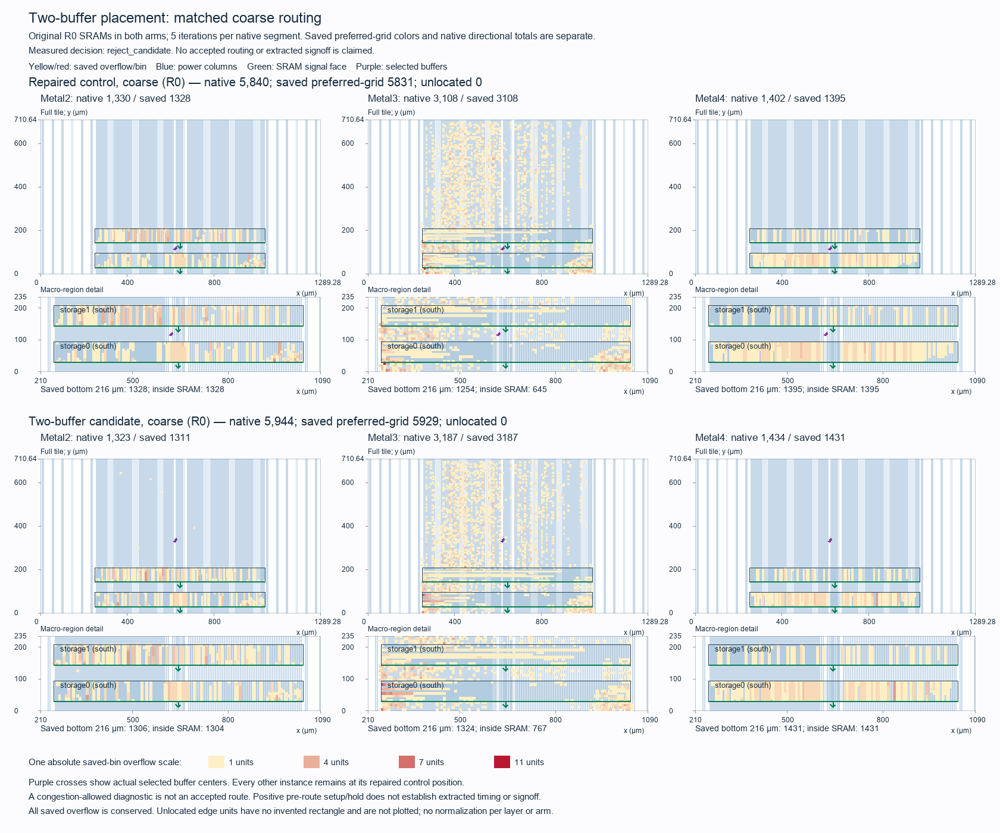

# Tiny Tapeout two-buffer placement comparison

The candidate is **rejected**. Moving only `fanout2803` and `fanout2903` preserves all three corner setup/hold margins, but matched coarse routing overflow rises **5,840 → 5,944 (+104, +1.781%)**. Retain the repaired R0 checkpoint. The [result manifest](../../physical/experiments/tt-buffered-two-buffer-results.json) and [frozen selection](../../physical/experiments/tt-buffered-two-buffer-selection.json) bind the evidence.

The source ODB is `95f0fdb260de137d5b4f77669c9aaa5eb3bf56e7dc55f4c9b7d51b2b8a16556e`; the candidate is `3371579846089198dc10504980d4dfdc8e2d4570077349ed2806d8f6a2164f65`. One native DPL uses the two frozen empty row slots, temporarily locks all other instances, restores original statuses and checks placement before writing the candidate. Native readback confirms exactly two moved instances and 28,960 unchanged instances, with zero neighboring movement. All masters, connectivity, clocks, rows, blockages, groups, pins, macro R0 orientations and footprints, complete power geometry, technology rules and initial NDR definitions/associations are unchanged. Core RTL, serial ABI and the canonical physical recipe remain unchanged. Synthesis, GPL, CTS and timing repair are not rerun.

| Buffer | Original lower-left, µm | Final lower-left, µm | Final orientation |
| --- | --- | --- | --- |
| fanout2803 | 622.56, 117.18 | 622.56, 336.42 | R0 |
| fanout2903 | 618.72, 113.40 | 618.72, 328.86 | R0 |

The second cell changes MX to R0 to match its destination row. Both exact target boxes survive legalization. Four unique incident-net center-HPWL proxies fall 2,811.48 → 2,391.90 µm (−419.58 µm); both output bounding-box proxies stay unchanged. These are placement proxies, not routed length or delay.

Both arms use identical pinned tools, libraries, SDC, Metal2–4 capacities and five iterations per native routing segment. Native automatic clock-NDR fallback remains enabled. Its actual downstream response is eight control fallbacks and seven candidate fallbacks; post-GRT rule state is not asserted identical. Neither congestion-allowed route is accepted routing. Historical full 50-iteration counts remain separate.

| Native routing measure | Repaired control | Two-buffer candidate | Change |
| --- | ---: | ---: | ---: |
| Metal2 overflow | 1,330 | 1,323 | −7 |
| Metal3 overflow | 3,108 | 3,187 | +79 |
| Metal4 overflow | 1,402 | 1,434 | +32 |
| Total overflow | 5,840 | 5,944 | +104 |
| Saved preferred-grid overflow | 5,831 | 5,929 | +98 |
| Zero-capacity marker overflow | 3,328 | 3,472 | +144 |
| Fully inside SRAM footprints | 3,004 | 3,148 | +144 |
| Native wirelength, µm | 2,516,270 | 2,524,600 | +8,330 |

All saved overflow units have locations; native directional and saved preferred-grid representations remain distinct. The figure uses one absolute scale, unchanged axes and actual power/signal geometry. Purple crosses identify the two selected buffers. Candidate buffers appear in the full-tile panels above the macro-detail window.

The two input nets' zero-capacity source incidences fall 100 → 0. Output `net2903` gains 14 such incidences, leaving the four-net cohort at 100 → 14. Its co-occurring overflow falls 187 → 134. Other zero-capacity source incidences rise by 230, outweighing that local decrease of 86. The [native marker analysis](../../build/physical/tt-buffered-two-buffer-marker-analysis-01/report.json) therefore supports the intended local input-path improvement, while whole-tile routing pressure grows. Participation counts describe exposure; they do not allocate causal ownership of overflow. Power overlap and NDR warnings do not justify waivers.

| Fresh estimated timing | Control setup / hold, ns | Candidate setup / hold, ns |
| --- | ---: | ---: |
| Typical | +6.361640 / +0.164109 | +6.361640 / +0.164109 |
| Slow | +1.008250 / +0.278249 | +1.008250 / +0.278249 |
| Fast, conditional | +9.588290 / +0.096047 | +9.588290 / +0.096047 |

Setup/hold violation counts stay zero. Slew counts remain 0/2/0, fanout counts 254 at each corner and capacitance counts zero. The two slow slew failures remain on both SRAM DIN[8] inputs; the long reset/control-dependent address path remains the timing bottleneck. STA uses placement parasitics. Fast retains the −40 °C logic/I/O and −55 °C SRAM qualification.

Fresh native power readback passes VPWR/VGND connectivity, full supply wire/via/boundary geometry, original SRAM supply contacts, all 43 TT signal-pin shapes, technology/NDR rules and exact two-cell movement. Grid SHA256 remains `1598525bac6715417b1c54500a99a5751cdb53f0d83a0348f5f570531ec1ebb7`. A fresh export of the same candidate passes 21 public-pin protocol peers, 400 request/response pairs, 336,426 zero-delay edges and three parser negatives in 121.750 s. The logical netlist bytes remain identical to the source. This is finite functional acceptance, not universal equivalence or physical qualification.

All eight scheduled phases and cleanup complete at 2026-10-12T19:45:00.090400+00:00, 922.090 s after the 19:29:38 UTC start, within the 1,500 s wall cap. Seven native operations total 217.637 s; the mapped supervisor uses 121.856 s. Preparation, analysis and publication also stay inside the fixed 19:54:38 UTC deadline. The one host rendering failure and its bundled-runtime recovery are retained; they add no CAD run. Owned containers are absent and the mapped process group is stopped. Current source custody and [independent review](../../build/physical/tt-buffered-two-buffer-review-01/final-custody-review.json) pass.

The original Librelane source flow remains failed on 30,396 inherited pre-helper power-grid metrics. Fresh connectivity does not waive that historical failure. Accepted routing, detailed routing, extracted timing, SRAM corner qualification, DRC/LVS and official precheck remain open. No second placement candidate, full-routing attempt, commit, push or submission occurs in this experiment.
