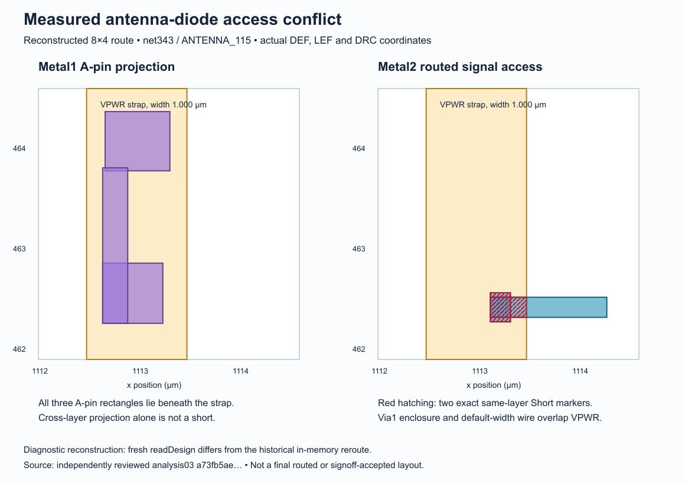

# 8×4 routing and extraction campaign — morning report

**Final report: 23 October 2026. Compute and keep-awake custody closed at
06:40:11 UTC. Local commits and final validation are recorded below.**
Approved window: 22 October 21:00:35 through 23 October 09:00:35 UTC.
New physical candidates closed at 03:00:35; new numerical experiments at
05:00:35. [Preserved campaign contract](streaming-8x4-campaign-20261022.md).

**Tapeout remains open.** The official 8×4 integration works. The sole repaired
candidate reached a clean internal route, but its later antenna reroute did
not close. A diagnostic reconstruction now identifies concrete signal access
conflicts with Metal2 power straps near newly inserted antenna diodes. The
extraction campaign also found measured resistance and capacitance gaps;
no applicable CMOS5L model or qualified extracted chip timing was established.

The strongest new routing evidence is the retained geometry: all 42
reconstructed markers have direct same-layer explanations, including 36 exact
signal/PG intersections and six gaps below the Metal2 spacing minimum.
That gives the next physical repair a
specific target. Extraction qualification remains the broader and likely
harder task: fitting one case already failed to predict an untuned spacing.

## Acceptance gates

| Gate | Result | Evidence and remaining condition |
|---|---|---|
| Official 8×4 integration | **Pass, integration scope** | Fresh 1724.16 × 710.64 µm allocation, 43 public pins, 70 complete PG stripes, 680 DBU minimum public clearance, unchanged official Pincheck passes. [Committed receipt](evidence/streaming-8x4-20261022/integration.json). |
| Completed clean routing and connectivity | **Incomplete** | No completed whole DetailedRouting state or eligible final ODB. Internal zero DRC and the bounded reconstruction do not pass this gate. |
| Applicable CMOS5L extraction model | **Incomplete** | Independent M1 reference passes its limited empirical gates; complete finite-wire pilots fail, consumer accuracy/coverage/corner evidence remains missing. |
| Qualified extracted timing | **Not established** | Nominal pre-new-diode repair STA has setup +9.87919 ns, hold +0.0771534 ns and zero fanout violations. No qualified final extracted graph exists. |
| Final implementation correspondence and public wires | **Not run on final target** | Historical source/foundation reuse is authenticated. Fresh final-target mapping, complete proof/private controls and full SPI/JTAG/I²C/UART regression remain required. |
| GDS DRC, antenna, transistor LVS and PG connectivity | **Not run on final target** | No eligible final target. Geometric integration checks do not establish these physical results or IR/EM. |
| Complete official precheck | **Not run on final target** | All nine applicable unchanged checks remain required. |

The design retains the 64×64 program bank, depth-two RX/TX queues, 6,039 semantic
state bits, original host interface and full 20 ns timing/I/O contract. Logical
input SHA256 is `b8b0a29851369f2b181b67db77778979703a30adc92051e2992a2e8fb98dc971`.
The 4 KiB duplex SPI, 4,097-bit JTAG, 64-byte reactive I²C and autonomous UART
capacities were not reduced. Official support is pinned to
`d66cf179e7bc4d296362ab7e2e3b344dc3c4f665`.

## Routing: what happened and what the captures establish

The original full flow plateaued at 28 Metal2 shorts and was stopped to preserve
the sole repair allowance. The canonical post-antenna repair added four buffers
on two overloaded nets, retaining their original 15/11 recursive leaf endpoints.
Its nominal STA removed the measured fanout violations. Placement/global routing
also changed, so the routing improvement cannot be attributed solely to buffers.

Repair02 reached zero router violations in internal `drt-run-0`. Antenna checking
then found 35 net / 36 pin violations and inserted 39 diodes. Its next reroute's
last completed iteration reported 40 Metal2 violations: 36 shorts and 4 spacing.
The supervisor stopped it near the fixed 6 GiB container limit; the last retained
observation was 94.87%, with host availability at least 57%. This was a resource
preemption, with no observed OOM. The whole DetailedRouting step never completed.
All 53 retained artifacts rehash and the final-target selector correctly rejects
it. The one-repair allowance is consumed.
[Repair specification and terminal readback](streaming-8x4-optional-postantenna-repair-20261022.md).

A separately declared **same-candidate diagnostic reconstruction** starts from
that exact clean internal ODB. It reproduces 35/36 antenna violations and exactly
39 new diode masters, 42,138 → 42,177 instances, before a six-iteration route.
It adds no repair or physical candidate. Native execution finishes in 221.704 s
with exit 0 and retains pre/post-diode and postroute ODB, DEF, guides, netlists,
complete instance/terminal censuses and all violation coordinates.

The frozen HOST adapter nevertheless fails: Rich display padding breaks its
version-line equality, and its next argv check expects an absolute executable
rather than the actual canonical alias. Its original report and outer receipt
remain failed 2. A separate read-only shape analysis preserves those failures
and independently authenticates the raw captures, runtime/input custody and
complete 150-input guard join. No corrective acceptance receipt is substituted.

That analysis finds:

- 42 Metal2 records: 36 Short and 6 Metal Spacing, all pairing PG with one of
  19 newly diode-loaded signal nets.
- All 36 Short rectangles exactly match actual signal wire/via/patch geometry
  intersecting Metal2 PG stripes. Every one also projects onto the associated
  new diode A pin. Cross-layer projection alone is not the electrical proof.
- Fifteen of 39 new diodes have all A-pin rectangles beneath one of the 70
  Metal2 strap projections. Their locations do not change during this route.
- None of the 35 touched single-driver nets exceeds ten endpoint loads;
  endpoint counting is not STA or an electrical fanout-limit check.
- The six spacing-marker boxes equal actual PG/signal gaps: four at 0.08 µm,
  two at 0.20 µm, all below the complete retained Metal2 table's 0.21 µm minimum.
  A separate fixed-data analysis and Root rederivation agree on every rectangle.

The reconstruction uses fresh `readDesign`; the historical reroute used
in-memory `updateDesign`. These 42 shapes cannot be equated to the historical
40. The spacing text does not name the internal checker rule; its geometric
incompatibility with the retained LEF table is independently established.
New diode PG ITerms remain unassigned at this pre-`write_views` point; final global
connections were not executed. No final physical acceptance follows.
[Full reconstruction, exact example and limits](streaming-8x4-route-replay-20261023.md).

The source audit also confirms both antenna insertion paths already legalize
new diodes and refresh dirty routes/guides. Missing legalization or stale-guide
claims are retracted. The next cause-based investigation is **PG-aware diode
placement and access**, with checks after legalization and before rerouting.
More iterations or lower global density have not been shown to fix these local
intersections. Any further physical change belongs to a separately authorized
candidate.

## Extraction: executed results

| Study | Actual outcome | Meaning |
|---|---|---|
| Layered M1 independent FVM, 25 calls | **Limited empirical pass**; maximum mesh change 1.316004%, domain change 0.243027%, reported true residual ≤9.991928e-10 | Useful independent reference at declared cases; no rigorous continuum enclosure or full process-model qualification. |
| Complete uniform pilot, fresh 55 calls with `-f0` | All strict numerical/resource leaves pass; **complete pilot fails** one mesh gate | One of 11 cases changes 2.296835% against 2%; final change is 0.143815%. Posthoc length/domain/FVM comparisons cannot override the failed gate. |
| Complete real-stack 150-call policy | **Incomplete/failed** | Default OOC policy first exceeds the small scratch filesystem. Two exact in-core diagnostic leaves subsequently pass, but no complete pilot follows. |
| Finest M1 OOC point | **120 s timeout** | Exact count: 94,544 panels / 600,919,256 links. Peak cgroup memory 2,216,009,728 B, allocated scratch 8,521,777,152 B, no max/OOM events, owned scratch cleaned. No accepted matrix. |
| Extra-fine uniform point | **Stops before solve** | Native rounds the mesh header, which the strict parser rejects. Separate diagnostic counts imply 7,340,762,560 B conservative RAM versus a 6,120,328,396 B planning ceiling. No retry or fallback. |
| Upper-layer reference, 32 grids | All numerical leaves complete; **domain gate fails 3/8 cases** | TopMetal1 self 5.05555%, M3–M4 pair 2.50265%, M4–TopMetal1 pair 6.42107%, against 2%. |
| Fresh doubled-domain reference | **27 grids pass, grid 27 times out at 120 s, four unrun** | Complete reference stays false. Work 1,017.972 s; no memory/OOM event. |

The initial exit-zero GMRES/nonphysical-matrix failures are preserved. A fixed
conditioning study shows that interaction ratio 0.25 can pass selected points
that fail at 1.0, with geometry and tolerances unchanged. It does not prove a
whole mesh universe or independent solver-error enclosure.
[In-core diagnostic](streaming-8x4-rc-incore-preparation-20261023.md),
[finest-point evidence](streaming-8x4-rc-ooc-finest-20261023.md),
[upper references](streaming-8x4-rc-reference-expanded-20261023.md).

Actual extractor consumption exposes additional gaps:

- **Resistance:** all 72 original absolute wire-R controls fail the fixed 0.1%
  gate; all 30 named-via difference controls pass. A fresh 26-net study shows
  that local per-corner LEF sheet resistance plus `-lef_res` restores actual-width
  slopes: maximum error 0.001186%, half slope for doubled width, all 42 held-out
  length controls pass. Endpoint offsets persist: 123/126 new absolute checks
  fail. This is an experimental policy, not an adopted or qualified production
  corner model. [R results](streaming-8x4-rc-R-length-width-results-20261023.md).
- **M1 capacitance:** actual isolated self is 45.0244 versus 85.0550 pF/m in the
  stable reference, 47.06% low. Pair ground is 31.42% low. These comparisons are
  provisional because the mandatory finite-BEM prerequisite is absent. A fitted
  far-row development case matches its isolated training target but the untuned
  0.36 µm pair coupling remains 18.86% low and fails 10%. No retuning follows.
  [Far-row results](streaming-8x4-rc-cap-far-20261023.md).
- **Vertical coupling:** both five-layer consumer calls print zero for all four
  centered adjacent-layer families at all three lengths and fail strict
  measurement controls. A one-token synthetic lookup marker produces positive
  coupling with two exact 2 pF/m slopes. The declared 1 pF/m prediction fails;
  it is not retrospectively promoted. Pinned source accounts for two empty-side
  contributions accumulating into one CC segment; writer mirroring is not the
  factor. Generation code divides by two when storing this convention, but the
  exact historical generation binary/logs remain unknown. This identifies lookup
  semantics, not physical calibration. [Marker evidence](streaming-8x4-rc-cap-marker-20261023.md).

On the final live upstream check, [PR1237](https://github.com/IHP-GmbH/IHP-Open-PDK/pull/1237)
remains draft/open at the same `ffdafdbb4abb17316fa0ffd221ea99c0475c4734` head;
[ITF PR1251](https://github.com/IHP-GmbH/IHP-Open-PDK/pull/1251) remains merged at
`9182b4ff461d90948ade30b1614d5000128cb9f7`. The merge is provenance, not model
qualification. Its stated TopVia1 limits are copied from SG13G2 while the CMOS5L
specification lists resistance as TBD. The campaign does not resolve that
physical evidence gap.

The remaining model envelope includes widths beyond the single table width,
spacing and noncentered/nonadjacent/diagonal/orthogonal/shielding/end contexts,
actual generated and named vias, and justified MIN/TYP/MAX geometry and
correlation. ER-only sweeps are not process-corner qualification. A final-route
census must establish the actual required envelope.
[Full coverage ledger](streaming-8x4-rc-coverage-20261022.md).

## Work retained for the next campaign

The following are **unexecuted**. No result is credited:

- Independently reviewed exact five-grid completion and distinct composite32
  reader: 180 s/leaf, 1,050 s work, 1,110 s outer. It must reopen the original 27
  strict passes and all five fresh grids while preserving failed grid 27.
  [Prepared packet](streaming-8x4-rc-reference-completion-20261023.md).
- A proposal for one unchanged-runtime 600-second finest-M1 OOC point. It was
  not implemented or admitted. [Proposal](streaming-8x4-rc-ooc-600-proposal-20261023.md).
- Final-target export, complete M proof/private controls, full public-wire
  regression, fixed-target timing and physical/official signoff coordinators.
  Their target/model prerequisites never closed. The unexecuted PG checker now
  has the reviewed revision-query correction and 11 HOST controls; it still
  has no Native result. Other prepared adapters need their own admission review.

The replay is the last Native job: it ends at 02:06:38 UTC. Subsequent work is
HOST evidence analysis and closeout. The queued numerical packets did not
launch before the 05:00:35 cutoff and remain unexecuted. No new physical repair
or numerical experiment is started after its admission cutoff.

## Remaining difficulty and next gates

Routing is now a concrete local access investigation, although a repair is not
proven until the ordinary antenna-corrected flow completes with zero violations
and connectivity passes. Preserve all 39 required diodes and the original chip
contract while testing diode access around the actual PG geometry.

Model qualification is still substantial engineering. It needs coefficients
that predict untuned cases, complete consumer semantics and a credible corner
and via envelope. A converged solver or a good training fit is insufficient.
After route and model closure, bind the same final ODB, deck, extractor/SPEF,
annotation and propagated clocks for setup/hold/slew/capacitance/fanout checks;
then execute final circuit correspondence, public-wire regression, actual GDS
DRC/antenna/transistor LVS, PG connectivity and all official checks. There is no
defensible readiness percentage or delivery-time estimate from this campaign.
Final timing, implementation proof and signoff remain real engineering gates;
their outcome cannot be inferred before the prerequisite target and model exist.

## Evidence, validation and custody

Baseline: `df48101b2d94a5b1cdaadd3680e0342dcb257ed1`.
Branch: `codex/streaming-8x4-closure-20261022`. Incremental local commits retain
failed attempts and reviewed producers. No push, publication, external message,
paid service or fabrication submission occurred.

Local checkpoints include `0118b91` (native 8×4 integration), `a71092a`
(sole repair admission), `b9fd93e` (width-aware R study), `874fbe5`
(vertical lookup discriminator), `f06dc24` (captured routing reconstruction)
and `af697eb` (terminal geometry and extraction results). Prepared final-target
and proof coordinators in other commits are not completed verification results.

Runtime image:
`sha256:5825633bea1f9cbc705ece2de2bc31de6e4ec83d233739205a0f265ef9d92f92`.
OpenROAD: `dcf36133a369abc8f3c5e5738cd4d82e4903c0e0`.
FasterCap binary SHA256:
`b78b4938eb3e301653cee76808de12a5c37a5c567477f247b535a8319a1037d1`.

| Key retained receipt | SHA256 |
|---|---|
| Repair02 outer resource | `237d48c6b349ab7de03f1e72143acf829eb70ff3060e5582c588d0ec5312e68a` |
| Independent terminal routing review | `7bb9fa5fed39c675ac18ba9f46d64bc9f1c4409e69d75058202e1c02d76402f0` |
| Reconstruction shape analysis03 | `a73fb5aede7059b823d990d463bf95b0f2e9daaabdb0bc30a100ec4a1cdd1308` |
| Separate six-marker spacing analysis01 | `94d5d84be05a2fdcd9638d64af041901eb21eaf960e1344a5f77520942c57016` |
| Complete uniform55 reader, failed mesh gate | `81547850af1c84bcb4a8398f80c19a9c5e5ba30e1fd89a02faed6b57df717d2f` |
| Expanded reference reader, incomplete | `f7061991c8aea61b5de02867bd7f5bee1b2dd26cfc0184fed0e4ce94f5490ae2` |
| Marker reader, failed prediction gate | `633725e5669b788df4200af45db46c183f1b8c008136e7291308357f533bf59d` |
| Shared-lease/source file audit03 | `bc58259823fdb2cc8c387d78acbbbf02b192f3c004a301860af11199134e7230` |
| Final live custody and keep-awake cleanup01 | `92e674b07c4492cf178df6a1cff1d818900a01942547f897729f65052a618718` |

All raw owners, plans, exact argv, source snapshots, resource receipts and
independent readers are under `build/campaigns/8x4-20261022-01/` and
`build/streaming-tt-resources/`. Each linked result document names its immutable
reader/launcher and hashes. Reproduction uses those HOST readback argv on the
retained owners; choose a fresh output path and preserve every prior receipt.
The replay's original reader intentionally still fails; analysis03 is a separate
read-only reconstruction, not a replacement acceptance adapter. Four source-seal
entries in the two early manual-U owners now differ at their current checkout
paths. Exact historical Git and retained source bytes are authenticated
separately; the old receipts were not rewritten and their mathematics was not
replayed or upgraded. Reproduction of those owners must use their original
archived source snapshots. Ignored raw evidence remains local, not a remote
backup; source commits alone do not retain the complete runtime or raw CAD data.

The final HOST suite passes **354 tests in 9.708 s**, using
`python3 -B -m unittest discover -s test -p 'test_streaming_8x4*.py'`.
The two final changed families also pass their 11/9 focused controls normally
and under `python3 -O`. These validate harness and negative-control behavior,
not Native routing or silicon.

The file audit covers all 37 terminal resource owners, complete shared leases,
guards, declared-input membership and exact historical-source witnesses.
The final live audit freshly rehashes their reports and input seals, retaining
the four explicitly witnessed source drifts above. Under the exclusively held
shared lock, all 37 recorded PIDs and all 34 exact named containers are absent
on the verified local Docker endpoint. No related campaign process remains;
the cleanup sentinel is absent. Only the exact owned keep-awake PID 13625 is
signaled, after two birth/command/group checks, and its absence is confirmed.
No heavy work follows that closeout. The live receipt is
`build/campaigns/8x4-20261022-01/final-live-custody-01.json`.

The complete commit-range artifact-policy check passes, as do its 25 focused
controls. The first figure-placement refusal is preserved: the compact picture
was moved out of the raw-evidence tree, with only exact size/SHA exceptions for
its already committed historical bytes. Global 1 MiB per-blob and 25 MiB
changed-byte limits, raw-evidence classification and acceptance gates remain
unchanged. Final Git/validation identities and an exact report snapshot are
retained in `build/campaigns/8x4-20261022-01/final-closeout-01.json` and the
closing campaign journal.
